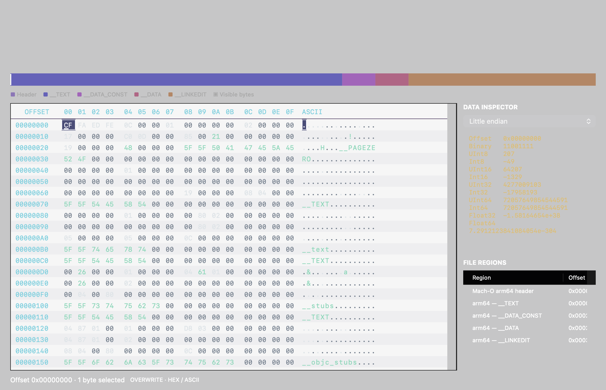

# DeepHex

A macOS binary editor built entirely with AppKit and Objective-C++17. Explore hex and ASCII side by side, edit bytes without shifting file offsets, and inspect executable structure and numeric values. No Qt dependency.

The macOS bundle uses [`img/favicon.icns`](img/favicon.icns), with visible icon representations from 16 through 1024 pixels, and loads it directly at startup. Its vector source is [`img/favicon.svg`](img/favicon.svg).



## What's new in 2.0

- Qt has been removed from the application, build, parsers, and tests. The workbench uses native AppKit menus, a customizable toolbar, split views, scroll views, file panels, alerts, clipboard, and undo manager; the binary parsers use standard C++.
- A resizable workbench with native macOS controls, System/Light/Terminal appearance, a data inspector, and a navigable file-region sidebar. Terminal replaces the separate Dark preset and is used automatically when System follows macOS dark mode.
- An overview color legend generated from the displayed regions: zero-filled, ASCII text, and binary distribution bins, or named executable headers/segments. The outlined marker identifies the visible bytes; the legend wraps with the window and follows appearance changes.
- A virtualized hex/ASCII editor with real vertical and horizontal scrollbars, trackpad scrolling, grouped bytes, keyboard navigation, and drag selection with edge scrolling.
- Hex nibble editing and printable ASCII editing, undo/redo, explicit Copy as Hex, strict hex or UTF-8 paste, and zero-fill selection. A two-digit hex edit is one undo step.
- Save and Save As use atomic replacement. Unsaved-change prompts protect opening another file and closing the window; saving warns if the original changed on disk.
- Hex and case-sensitive UTF-8 search, next/previous matches with wraparound, and Go to Offset.
- Signed/unsigned 8-, 16-, 32-, and 64-bit values, binary, float32, and float64 with selectable byte order. Values unavailable at EOF are shown as a dash rather than read past the buffer.
- Bounds-checked Mach-O and ELF region parsing: 32-/64-bit, both byte orders, and universal Mach-O architectures. Malformed or unrecognized files fall back to a zero/text/binary distribution overview.
- Drag-and-drop opening, recent files, command-line opening, Finder “Open With” support, and remembered window layout and appearance.

## Build on macOS

Requires macOS 12+, CMake 3.21+, and Apple's C++17/Objective-C++ compiler. Install Apple's Command Line Tools if needed (`xcode-select --install`), then:

```bash
brew install cmake ninja
cmake -S . -B build -G Ninja -DCMAKE_BUILD_TYPE=RelWithDebInfo
cmake --build build --parallel
open build/deephex.app
```

Open a file directly from the terminal:

```bash
./build/deephex.app/Contents/MacOS/deephex /path/to/file.bin
```

The build produces a local `.app` bundle, not a signed/notarized distributable. It links only Apple system frameworks and libraries; no third-party GUI runtime or deployment step is needed. Other operating systems are not supported.

## Appearance

**Terminal** is the dark palette: cyan offsets and headers, teal printable bytes, amber inspector values, muted zero bytes, and subtle purple dividers. **View → Appearance → Terminal** keeps it enabled regardless of the system appearance. Text, caret, and selection colors remain opaque; only the background surfaces are tinted.

**Translucent Background** enables an AppKit `NSVisualEffectView` with behind-window HUD material rather than lowering the whole window's opacity. The material extends through the native title bar; a light 8% charcoal root tint, 4% editor tint, and 7% alternating-row tint let more of the material show through without dimming text, caret, or selection. The region table also stays clear instead of painting opaque alternating rows. Translucency is enabled by default in Terminal, including System dark mode, and can be turned off for an opaque version of the same palette. macOS **Reduce Transparency** automatically replaces the material and clear native backing with opaque backgrounds without forgetting your preference; changing that accessibility setting updates an open window.

**System** remains the default: macOS light mode uses the native light palette, and macOS dark mode uses Terminal. **Light** forces the light palette; there is no separate Dark preset. Existing Dark and Terminal preferences now both select Terminal. Appearance and translucency preferences persist between launches, and switching them preserves bytes, selection, and undo history. The preview above is a rendered AppKit editor surface, excluding the title bar and desktop backdrop.

## Editing

| Action | macOS shortcut / interaction |
| --- | --- |
| Open / Save / Save As | ⌘O / ⌘S / ⇧⌘S |
| Undo / Redo | ⌘Z / ⇧⌘Z |
| Copy as Hex / Paste | ⌘C / ⌘V |
| Select All | ⌘A |
| Find / Next / Previous | ⌘F / ⌘G / ⇧⌘G |
| Go to Offset | ⌘L |
| Switch hex / ASCII editing | Tab, or click the desired column |
| Move / extend selection | Arrow keys / Shift + arrows; Home, End, Page Up, Page Down |
| File beginning / end | ⌘Home / ⌘End |
| Navigate regions | Double-click a sidebar region, or click/drag the overview strip |
| Zero bytes | Edit → Zero Selected Bytes, or the editor context menu |

Go to Offset accepts decimal or `0x`-prefixed hexadecimal. Hex search/paste accepts pairs such as `DE AD BE EF`, with optional whitespace, but no `0x` prefixes. ASCII typing accepts printable ASCII; pasting in that column writes UTF-8 bytes. Selecting bytes does not modify the clipboard.

### Deliberate limits

This is an **overwrite-only, in-memory editor**, supporting files up to **256 MiB**. Editing does not insert, delete, or shift bytes. Pasting starts at the beginning of the selection and must fit within the file; it selects the pasted bytes without resizing the file. The inspector reads forward from the first selected byte, regardless of selection length. Search runs synchronously and can pause the UI on large files. Executable maps describe file offsets, not a live process's virtual memory.

## Verification

Three regression suites cover contiguous overview coverage, executable endianness and segment offsets, universal Mach-O architectures, malformed input fallback, overview navigation bounds, empty files, selection and keyboard boundaries, drag edge scrolling, nibble undo/redo and clean-state transitions, overwrite/zero undo, strict hex and UTF-8 paste, cancel/discard protection, atomic saves and file permissions, Save As, external-change warnings, search overlap/wraparound, EOF inspector values, and preserving document selection and undo/clean state across appearance changes.

```bash
ctest --test-dir build --output-on-failure
```

The parser suite is plain C++; editor and document suites exercise real AppKit windows and alerts and require a logged-in macOS GUI session. They use temporary files and separate test preferences; the editor suite restores the system clipboard on successful completion. Disable test targets with `-DBUILD_TESTING=OFF` if only the application is needed.
